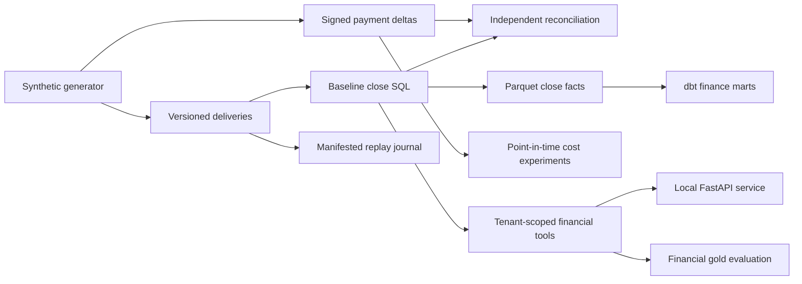

# Local platform architecture

Payment deltas are signed numeric adjustments. The ledger does not use cryptographic signatures. The portable build preserves the existing materialized close and separately validates journal replay. The journal is the integration boundary for future close ingestion. The API opens the verified baseline SQLite database in read-only mode.
