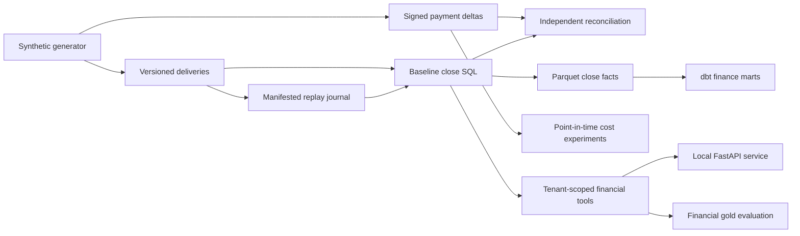
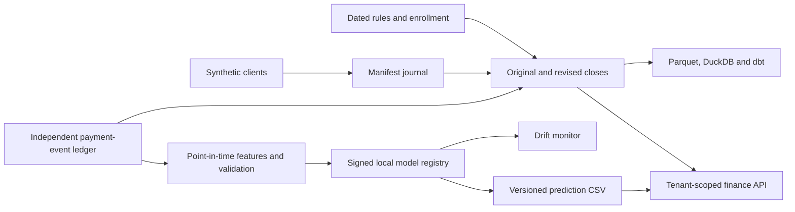

# Local platform architecture

Payment deltas are signed numeric adjustments. The ledger does not use cryptographic signatures. The journal-backed close recomputes both cutoffs in a separate database using accepted deliveries and the existing independent ledger. The baseline command remains available. The API can open either verified SQLite close database in read-only mode.

The V2 path is `synthetic source → transactional journal → original/revised member-month closes → Parquet → dbt finance marts`. Payment-event deltas independently verify the paid amounts at both cutoffs. The finance API reads the published SQLite snapshot and prediction CSV. The offline model path trains on point-in-time cohorts, runs validation-only selection, signs a ridge artifact, and monitors feature and prediction distributions before or after rollback.

The live local reference stack adds TLS Keycloak and Qwen inference as separate containers. Keycloak issues signed access tokens with tenant, scope and role claims. The API uses the model to propose an operation, then runs parameterized SQLite queries and builds the user-facing evidence from those rows. Model, identity and API processes communicate on the Compose network, with development endpoints on loopback.
