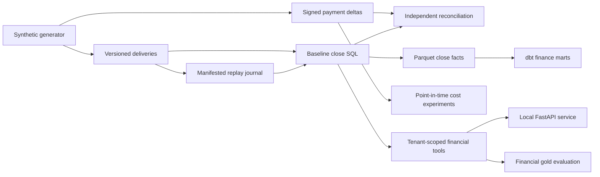

# Local platform architecture

Payment deltas are signed numeric adjustments. The ledger does not use cryptographic signatures. The journal-backed close recomputes both cutoffs in a separate database using accepted deliveries and the existing independent ledger. The baseline command remains available. The API can open either verified SQLite close database in read-only mode.
